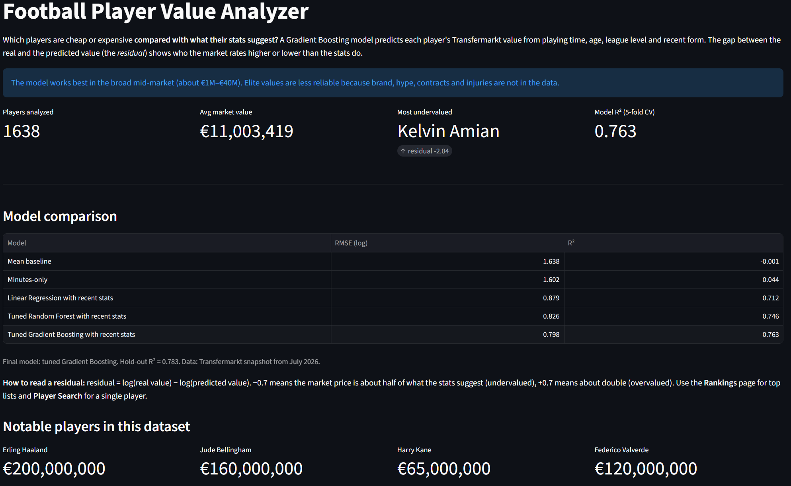

# Football Player Value Analyzer

[](https://github.com/AkArtem/football_player_value_analyzer/actions/workflows/tests.yml)

Identifying over/undervalued football players by comparing their actual market value to what a model predicts based on their performance stats.

**[Live Demo](https://football-value-analyzer.streamlit.app/)**



# Overview

I take performance stats (goals, assists, minutes played, age, position, league level) and try to predict a player's market value from that. Then I look at the difference between the actual value and the predicted value (residual), a big negative residual means the player is probably undervalued relative to their stats, a big positive one means overvalued.

This project demonstrates data cleaning, SQL, exploratory analysis, and modeling on a real-world, imperfect football dataset. This is a current value analysis, not a forecast of future seasons. The target is each player's latest available market value, updated within the last 365 days.

# Key Results
- **4,816 players** analyzed after data cleaning vs 50149 in players.csv
- **Gradient Boosting (tuned):** out-of-fold R² = 0.763, RMSE = 0.798 (log scale) vs R² ≈ 0 for the mean baseline; R² = 0.783 on a 20% hold-out not used for tuning
- Robustness checks: residuals averaged over 5 CV seeds with a per-player stability score; changing the freshness cutoff (90–540 days) changes residual ranks no more than CV noise
- Feature logic covered by unit tests (pytest, run on every push with GitHub Actions)
- Live interactive dashboard deployed on Streamlit Cloud

# Skills Demonstrated
- Data cleaning & quality auditing (staleness, time-aware feature windows, low-sample noise)
- SQL (JOINs, CTEs, window functions: ROW_NUMBER/RANK/DENSE_RANK/LAG)
- Feature engineering, EDA, ML modeling with cross-validation, robustness checks
- Testing (pytest) and CI (GitHub Actions)
- Deployment (Streamlit Cloud)

# Data

Source: [davidcariboo/player-scores](https://www.kaggle.com/datasets/davidcariboo/player-scores) on Kaggle, scraped from Transfermarkt. Snapshot used here: downloaded 2026-07-11 (latest valuation 2026-02-27; upstream updates are currently paused).
Raw CSVs aren't committed here because of file size, see [data/README.md](data/README.md) for which files you need and how to set them up.

### Data problems found and fixed

This dataset required significant cleaning before it could be used reliably.
Full details in [data/README.md](data/README.md), summarized here:

- **Valuation staleness:** median time since last valuation update across all players is ~2.7 years; 81% of records are older than 12 months. Analysis is restricted to players with a valuation update within the last 365 days.
- **Missing appearance data:** 390 players (6.5%) had a valuation but no match appearance records - excluded from the feature set.
- **Time-aware features:** all stats are computed only from matches on or before each player's own valuation date (covered by a unit test).
- Final analysis dataset after cleaning: **4,816 players**.

## Tech Stack

- Python: pandas, numpy, scipy, scikit-learn, matplotlib, seaborn, joblib, Streamlit
- Testing / CI: pytest, GitHub Actions
- SQL: sqlite3 (in-memory), queries in `sql/`
- Git/GitHub

## Repository Structure

```
notebooks/ — data cleaning, SQL queries, EDA, modeling, sensitivity analysis
src/       — reusable feature functions (time filter, recent window, league tier, per-90)
tests/     — pytest tests for src/ and the dashboard data
sql/       — SQL queries (JOINs, CTEs, ROW_NUMBER/RANK/DENSE_RANK, LAG)
data/      — data docs (raw files not committed, see data/README.md)
app/       — Streamlit dashboard (reads dashboard_data.csv and metrics.json)
```

## Notebooks (in order)

1. `01_data_overview.ipynb` — loading and checking all the raw tables
2. `02_data_check.ipynb` — valuation freshness, current/peak value per player
3. `03_features.ipynb` — first version of feature engineering
4. `04_check.ipynb` — time-aware feature checks, final clean feature table
5. `05_sql.ipynb` — SQL queries: top scorers, per-90 stats, ranking by position, value change over time, main league per player (checked against pandas)
6. `06_eda.ipynb` — exploratory analysis on the clean data
7. `07_modeling.ipynb` — baselines, linear models, Random Forest and Gradient Boosting with CV and tuning, permutation importance, residual analysis, hold-out check
8. `08_sensitivity.ipynb` — does the ranking depend on the freshness cutoff (90/180/365/540 days)?

## SQL

All queries in `sql/`, run through sqlite3 from Python. Covers JOINs, aggregation, RANK()/DENSE_RANK() (ranking players within their position), LAG() (tracking how a player's value changed over time), and a CTE + ROW_NUMBER() query that finds each player's main domestic league - the same feature as in `src/features.py`, and both versions agree for 100% of players.

## Modeling results

Model selection happened in two stages: a broad comparison of baselines and linear models on a single train/test split (base features), followed by 5-fold cross-validated, out-of-fold evaluation of the final candidate feature set (recent-form stats + league tier) to pick and honestly score the deployed model.

**Stage 1 - baseline exploration (single train/test split, base features)**

| Model | RMSE (log scale) | R² |
|---|---|---|
| Mean baseline | 1.686 | -0.0004 |
| Median baseline | 1.689 | -0.0041 |
| Age-only | 1.600 | 0.0988 |
| Minutes-only | 1.640 | 0.0541 |
| Linear Regression | 1.206 | 0.4885 |
| Lasso | 1.217 | 0.4787 |
| Ridge | 1.206 | 0.4887 |

**Stage 2 - final validation (shuffled 5-fold CV, out-of-fold predictions, recent-form + league-tier features)**

| Model | RMSE (log scale) | R² |
|---|---|---|
| Mean baseline | 1.638 | -0.001 |
| Minutes-only | 1.602 | 0.044 |
| Linear Regression | 0.879 | 0.712 |
| Tuned Random Forest | 0.826 | 0.746 |
| **Tuned Gradient Boosting** | **0.798** | **0.763** |

Tuned Gradient Boosting (500 trees, depth 3, learning rate 0.03) is the final model. On a 20% hold-out that was not used for tuning it reaches R² = 0.783 (the hold-out was used once to compare the final candidates, so it is not a fully untouched test set). Compared with Random Forest it also reduces the underprediction of the most expensive players (mean residual of the top-100 most valuable players +0.50 vs +0.70). All numbers come from `app/metrics.json`, which the dashboard reads directly.

An RMSE of 0.8 on the log scale means a typical prediction is off by a factor of about 2.2, so the model is meant for ranking players against their stats, not for exact prices.

Permutation importance on the hold-out set: league tier (0.35), total minutes (0.26), recent minutes (0.20), age and age² (≈0.15 each). Per-90 stats and position add little.

## Robustness

- **Freshness cutoff:** the 90–540-day datasets share 94–100% of players with the 365-day one (most valuations in the snapshot are from December 2025), so the cutoff barely changes the sample. On common players, residual ranks agree with Spearman 0.975–0.980 — the same as re-running the 365-day model with another CV seed (0.979) (`08_sensitivity.ipynb`). This shows the choice of 365 days is not critical; it is not a test on a different population.
- **CV randomness:** residuals in the dashboard are averaged over 5 different CV splits. `residual_std` shows how much a player's prediction moves between splits (mean 0.08); the dashboard can hide the ~6% of players with residual_std > 0.15.

## Residual analysis

Residual = actual log(value) - predicted log(value). Negative means the model thinks the player should be worth more than the market says (undervalued). Positive means overvalued.

Patterns in the biggest residuals:

1. **Market value far above the estimate:** mostly young players (median age of the top 30: 24.5) with very few recent minutes in the data (median 329). The market pays for potential, which isn't in the data. Long injuries look the same: Rodri or Musiala missed most of a season, so the model sees few recent minutes, while the market knows they will come back. Players who recently arrived from a league the dataset does not cover (Gerson, Ardon Jashari) also land here.
2. **Market value far below the estimate:** mostly cheap players (median value of the top 30: €100K, median age 23.5) with relatively few career minutes; 18 of the 30 play in tier-1 (smaller) leagues. Their stats look decent, but their price is at the bottom of the range.
3. **By position** there is no systematic bias (median residual between −0.06 and −0.02), and goalkeepers have the smallest spread (std 0.73 vs 0.79–0.81).

Residuals also depend on price level (regression to the mean): cheap players have negative residuals on average and expensive players positive ones (from −1.11 under €100K to +0.50 over €50M). A negative residual for a cheap player is therefore not automatically a bargain, which is why the dashboard also shows each player's percentile **within his price group**.

## Known Limitations

- Transfermarkt valuations are editorial estimates, not actual transaction prices.
- Injury history and transfer demand are not in the data. `players.csv` does contain a contract expiry date, but only as of the snapshot date, not as of each valuation date, so I left it out to avoid using information from the future.
- The dataset covers 14 European first divisions plus cups and European competitions. Minutes played in other leagues (e.g. Brazil, Switzerland, MLS) are missing, so players who recently moved from there look less experienced than they are and often appear "overvalued" (e.g. Gerson, Ardon Jashari).
- Predictions are pulled towards the middle of the market: the cheapest players are systematically predicted too high and the most expensive too low.
- Fixed data snapshot (downloaded July 2026); 93% of the valuations used are from December 2025.
- **Selection bias from the freshness filter:** part of the staleness comes from the dataset's scraper, not from Transfermarkt. For example, Mbappé, Vinícius Júnior and Lamine Yamal were last valued in mid-2024 in this dataset, so they are excluded, and only a minority of Real Madrid's and Barcelona's current squads pass the 365-day filter vs most of Manchester City's. The sample under-represents some top clubs.
- Market value prediction is a well-studied problem; this project's differentiator is execution depth and data quality rigor (time-aware features, staleness-aware filtering, robustness checks), not methodological novelty.

## How to run locally

```bash
git clone https://github.com/AkArtem/football_player_value_analyzer.git
cd football_player_value_analyzer
pip install -r requirements.txt
python -m pytest -v
```

Download the dataset from Kaggle (see `data/README.md`), put the CSVs in
`data/`, then run the notebooks in order (01 → 08).

Streamlit app:
```bash
streamlit run app/streamlit_app.py
```

## License

MIT